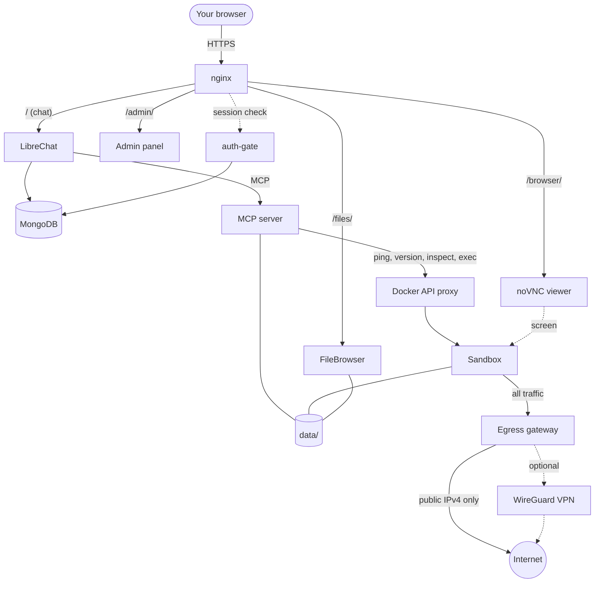

# LibreBox

[](https://github.com/Kirill-Vaa/LibreBox/actions/workflows/lint.yml)
[](https://mypy-lang.org)
[](https://github.com/LibreChat-AI/LibreChat/releases)
[](#sandbox-image)
[](#development)
[](LICENSE)

Give your AI agents their own computer. LibreBox runs [LibreChat](https://librechat.ai) on your machine and connects its agents to an Ubuntu sandbox. Through 17 MCP tools, the agents work there as root, keep servers and long jobs running in the background and save their results to a file manager in the LibreChat sidebar. When an agent opens a web page, you watch its Chrome window live and can take over to sign in or solve a captcha. The default image comes with about 200 tools and libraries, from Go, Python and Rust to the AWS CLI, ffmpeg and pandoc, and the `full` image adds about 150 more, including LibreOffice, Metasploit and PyTorch.

<!-- Demo 1 -->

Two things to know before you start:

- The sandbox is isolated from your machine. It is a separate container that shares only the `data/` folder with the host and, by default, reaches only the public internet (see [What keeps the sandbox contained](#what-keeps-the-sandbox-contained)).
- LibreBox is meant for one person. All accounts share the same sandbox, files and browser (see [What LibreBox does not isolate](#what-librebox-does-not-isolate)).

## What you get

### An Ubuntu sandbox that keeps its state

The agent runs commands with `bash -lc` as root in an Ubuntu 26.04 container and installs whatever else it needs. Servers, builds and downloads run as background jobs that keep going after the agent's turn ends, and the agent can read their logs later. The sandbox has no cron, Docker daemon or running systemd, so background jobs take the place of services.

The agent's workspace, `/root/data`, is the `data/` folder of your checkout, so its files survive when the container is recreated. Packages installed anywhere else last only until then. The image comes in three sizes, called tiers, from about 3 GB to about 42 GB (see [Sandbox image](#sandbox-image)).

LibreChat reaches the sandbox through LibreBox's [MCP](https://modelcontextprotocol.io) server. MCP is the standard protocol for giving models tools. The chat lists the server as Sandbox, and Agent Builder lists it as LibreBoxMCP (see [Sandbox tools](#sandbox-tools) and [Instructions for the agent](#instructions-for-the-agent)).

### A browser you can watch and use

The agent browses in a visible Google Chrome window, which it drives from the shell with [playwright-cli](https://github.com/microsoft/playwright-cli), Microsoft's command-line tool for Playwright. The globe icon in the LibreChat sidebar, labeled Browser, opens the Browser view at `/browser/`, which shows the sandbox's 1920x1080 display through [noVNC](https://novnc.com). Your mouse and keyboard work there too: when a step needs a person, such as a 2FA code, a captcha or a login, the agent asks you to do it there and then carries on.

A server the agent starts is reachable only inside the sandbox, so you open it in the Browser view at `http://localhost:<port>`. Sign-ins last until the agent closes its browser session. To keep them, ask the agent to open the browser with a profile folder in `data/`.

<!-- Demo 2 -->

### The agent's files in a file manager

Everything the agent saves in its workspace appears in Files. The folder icon in the LibreChat sidebar opens `/files/`, a [FileBrowser Quantum](https://github.com/gtsteffaniak/filebrowser) view of `data/`, where you can upload inputs for the agent, preview and download what it produced or edit a text file. Like the Browser view, Files uses your LibreChat session, so there is no second password.

- Files attached to a chat message don't reach the sandbox, because LibreChat stores them outside `data/`. Upload them through Files instead.
- playwright-cli saves screenshots and page snapshots in `data/.playwright-cli/` unless the agent names another file. Files shows hidden folders like this one.

<!-- Demo 3 -->

### LibreChat, configured for agents

- Accounts: sign-up is closed, and accounts are created with `make create-user`.
- Agents: they can search the web, hand subtasks to subagents, ask you questions in the middle of a task, remember facts about you between chats and render HTML or diagrams as artifacts in a side panel. Chats can also run on a schedule.
- Chats: long conversations are summarized when they near the model's context limit, and temporary chats are deleted after 24 hours.
- Integrations: the [Composio](https://composio.dev) MCP server connects agents to third-party apps through each user's own Composio account.
- Models: seven providers are set up: Anthropic, DeepSeek, Google, Groq, OpenAI, OpenRouter and xAI. Put a provider's key in `.env` once for everyone, or leave it out and each user enters their own.
- Skills: instruction files that LibreChat hands to the model when a task calls for them. Every skill folder in `librechat/skill/` is available to all users (see [Skills and plugins](#skills-and-plugins)). Two examples come with LibreBox: ai-check scores how machine-made a text reads, and humanize rewrites text to sound less machine-made.
- Speech: voice input runs on Groq and read-aloud on OpenRouter.
- Web search: Serper finds pages, Firecrawl reads them and Jina reranks the results.

LibreChat's code interpreter and RAG file search are not set up.

## Requirements

- Docker: Docker Engine with the Compose plugin on Linux, or Docker Desktop on macOS. On Linux, your user needs access to Docker, for example through the `docker` group.
- Host tools: `bash`, `git`, `make` and `openssl`.
- Architecture: x86-64 or ARM64, including Apple Silicon. The sandbox image is built natively for the host, as `linux/amd64` or `linux/arm64`, so it runs without emulation.
- Kernel: Linux 5.6 or newer for the agent's file tools, and 6.2 or newer with Landlock (the kernel's sandboxing feature) for the file search tool. Without Landlock, the agent searches through `shell_execute` instead. Docker Desktop's VM meets both. On a Linux host, `uname -r` shows the kernel version.
- CPU: at least 4 cores, or a lower `SANDBOX_CPU_LIMIT` in `.env`. Docker refuses to start the sandbox when its CPU limit (4 by default) exceeds the number of cores available to Docker.
- Memory: about 3 GB for the idle stack. Under load, the sandbox can grow to its 8 GiB limit (`SANDBOX_MEMORY_LIMIT`) and the other containers to 4.25 GiB together, or 5 GiB with certbot and the VPN. On a machine with less than about 13 GB, lower the sandbox limit, for example to `3G` on a machine with 8 GB. The sandbox build runs many stages at once, so on Docker Desktop give the VM at least 16 GB while you build `full` with the stack running.
- Disk: about 40 GB with the default tier and about 100 GB with `full`, counting Docker's build cache, plus room for what the agent stores in `data/`. The build cache keeps each tool's stage, so that updates rebuild only what changed. Docker Desktop caps the cache at 20 GB by default, which is too small to keep `full`'s stages: raise `builder.gc.defaultKeepStorage` under Settings > Docker Engine, for example to `"120GB"`. `docker builder prune` frees the cache, at the cost of a full rebuild next time.
- Network: free ports 80 and 443, which are fixed in `docker-compose.yml`, and no host network in `10.88.0.0/24` or `10.88.1.0/24`, which LibreBox uses inside Docker.
- Host name: `localhost` works on your own computer. A server needs a domain name that points to it, and other devices on your LAN need a name they can resolve, for example through an entry in their hosts file, because nginx doesn't serve the site at an IP address.
- API key: one from at least one model provider, such as Anthropic, OpenAI or OpenRouter.

On Docker Desktop, the CPU, memory and disk figures apply to its VM, which you size under Settings > Resources.

## Quick start

These steps run LibreBox on your own computer at `https://localhost`. To install it on a server with a domain name, follow [Running on a server](#running-on-a-server) instead.

1. Clone the repository and create the configuration file:

   ```bash
   git clone https://github.com/Kirill-Vaa/LibreBox.git
   cd LibreBox
   make init-env
   ```

   `make init-env` copies `.env.example` to `.env` and fills the internal secrets with random values.

2. Add an API key for at least one model provider. In `.env`, uncomment the line for your provider and replace the placeholder with your key:

   ```dotenv
   ANTHROPIC_API_KEY=sk-ant-...
   ```

   You can also skip this step: LibreChat asks for a key when you pick a provider that has none in `.env`.

3. Start the stack. For a shorter first build, set `SANDBOX_TARGET=core` in `.env` first. Then run:

   ```bash
   make up
   ```

   The first run builds the local images, and most of the time goes to the sandbox image. A build from scratch took about 2 minutes for `core`, 6 for the default `standard` tier and 20 for `full`. `make up` waits until MongoDB, LibreChat and the sandbox pass their health checks, so you can create your account as soon as it returns.

4. Create your account. The first account becomes the LibreChat admin:

   ```bash
   make create-user EMAIL=you@example.com NAME="Your Name" USERNAME=you
   ```

   Leave the password prompt empty to get a generated password printed in the terminal.

5. Once `make ps` shows nginx as `healthy`, open `https://localhost`, accept the browser's warning about the self-signed certificate and sign in.

## First chat

Pick a model at the top of the chat. Then click the + icon at the bottom of the message box, choose Sandbox and ask for something that needs a computer:

```text
Check which Python version the sandbox has, then write hello.py that prints today's date and run it.
```

The reply shows each tool call the agent made.

To try the browser, click the globe icon at the bottom of the sidebar, which opens the Browser view in a new tab, and ask:

```text
Open https://example.com in the browser, tell me the page title and leave the browser open.
```

Without the last part, the agent closes its browser session when it finishes.

For regular work, create an agent, so that the sandbox tools stay attached to it:

1. Open Agent Builder in the menu on the left.
2. Enter a name and choose a model.
3. Under Tools, click + Add, then select LibreBoxMCP and any other tools you want.
4. Under Skills, choose All to let the agent use the skills. New agents start with skills off.
5. Click Create.

To chat with the agent, select it in the model menu at the top of a new chat. To apply a skill yourself, type `$` in the message box and pick it.

The shield icon next to the globe, labeled Admin, opens the [LibreChat admin panel](https://github.com/LibreChat-AI/admin-panel) at `/admin/`, which only accounts with LibreChat's admin role can use.

## Running on a server

1. Point a DNS A record for your host name, for example `chat.example.com`, at the server, and open ports 80 and 443 in the server's firewall.
2. On the server, clone the repository and create `.env`:

   ```bash
   git clone https://github.com/Kirill-Vaa/LibreBox.git
   cd LibreBox
   make init-env
   ```

3. Edit `.env`:

   - Set `DOMAIN=chat.example.com` and add your provider key, as in step 2 of the [Quick start](#quick-start).
   - If the server has fewer than 4 CPU cores, lower `SANDBOX_CPU_LIMIT`. With less than about 13 GB of memory, lower `SANDBOX_MEMORY_LIMIT` (see [Requirements](#requirements)). On a small disk, set `SANDBOX_TARGET=core`.
   - To keep the agent away from the services on the server's own public IP address, add that address to `EGRESS_BLOCK_CIDRS`, for example `EGRESS_BLOCK_CIDRS=203.0.113.10/32` (see [Sandbox network](#sandbox-network)).

4. Start the stack and create your account:

   ```bash
   make up
   make create-user EMAIL=you@example.com NAME="Your Name" USERNAME=you
   ```

   `make up` creates a self-signed certificate for `DOMAIN` on the first start, so the site already works over HTTPS, with a browser warning.

5. Get a Let's Encrypt certificate. The first command is optional: it tests the exchange against Let's Encrypt's staging server and saves nothing.

   ```bash
   make cert-issue EMAIL=you@example.com DRY_RUN=1
   make cert-issue EMAIL=you@example.com
   ```

   The new certificate takes effect at once.

6. Open `https://chat.example.com` and sign in.

nginx answers only for the name in `DOMAIN` and drops requests for the server's IP address or any other name, so `https://203.0.113.10` won't load even when `https://chat.example.com` does.

If the site sits behind Cloudflare's proxy, set `REAL_IP_PROVIDER=cloudflare` in `.env` and run `make restart`, so that the logs and rate limits see your visitors' addresses instead of Cloudflare's.

### Certificates

`make cert-issue` answers the HTTP-01 challenge through nginx on port 80, installs the certificate in `nginx/certs/` and starts the `certbot` service, which checks for renewal every 12 hours. It also adds `COMPOSE_PROFILES=certbot` to `.env`, so that later `make up` runs keep that service. After a renewal, nginx reloads within 15 minutes.

To use a certificate from another source:

1. If you ran `make cert-issue` before, remove `certbot` from `COMPOSE_PROFILES` in `.env` and stop the renewal service with `docker compose --profile certbot rm -sf certbot`. Otherwise it copies the Let's Encrypt certificate back within 12 hours.
2. Copy the certificate to `nginx/certs/fullchain.pem` and its key to `nginx/certs/privkey.pem`.
3. Run `make restart`, or wait up to 15 minutes for nginx to pick them up.

The self-signed certificate that `make up` creates is valid for 365 days, and nothing renews it. If you change `DOMAIN` while you still use this certificate, or once it expires, delete both files in `nginx/certs/`, run `make up` to generate a new one and then run `make restart`.

## Configuration

LibreBox is configured in three files:

- `.env` holds the domain, the secrets, the provider keys and the sandbox settings. `make init-env` creates it, and git ignores it.
- `librechat/.env` holds LibreChat settings that are not secret, such as the app title, the visible endpoints, the session lifetime and the rate limits. It is tracked in git.
- `librechat/librechat.yaml` defines the model endpoints, the MCP servers, the agent capabilities, speech and web search. It is tracked in git too.

After editing any of them, run `make restart`. It applies the changes and keeps the sandbox with its running jobs, with two exceptions: a changed `SANDBOX_` limit recreates the sandbox, and a new `SANDBOX_TARGET` needs `make reload` instead (see [Sandbox image](#sandbox-image)).

Keep provider keys in the root `.env`: `docker-compose.yml` sets those variables for LibreChat itself, so a key placed in `librechat/.env` is overridden.

### Variables in `.env`

The table follows the order of `.env.example`. The provider keys, the egress settings and the sandbox limits are commented out there, so uncomment a line to set that variable. Values marked "generated" are secrets that `make init-env` fills in. It replaces only their `REPLACE_WITH_` placeholders, so running it again doesn't change values that are already set. A model provider or web search service without a key asks each user for their own.

| Variable | Default | Purpose |
| --- | --- | --- |
| `COMPOSE_FILE` | `docker-compose.yml` | Read by Docker Compose. Leave it as it is, because `make` adds the VPN file when needed. |
| `COMPOSE_PROFILES` | not set | `make cert-issue` sets it to `certbot`, so that the renewal service starts with the stack. |
| `DOMAIN` | `localhost` | Host name of the site, used by LibreChat's URLs, nginx and the certificate. It must be a name, not an IP address. |
| `REAL_IP_PROVIDER` | `none` | Set to `cloudflare` when the site is behind Cloudflare's proxy. |
| `MONGODB_USER`, `MONGODB_PASSWORD` | `librebox`, generated | MongoDB's root account, created on the first start only. |
| `JWT_SECRET`, `JWT_REFRESH_SECRET` | generated | Sign LibreChat's session tokens. auth-gate checks the session for `/browser/` and `/files/` with the refresh secret. |
| `CREDS_KEY`, `CREDS_IV` | generated | Encrypt the API keys and MCP credentials that users save. After a change, the saved ones can't be decrypted. |
| `ADMIN_PANEL_SESSION_SECRET` | generated | Session secret shared by LibreChat and the admin panel. |
| `ANTHROPIC_API_KEY` | not set | Anthropic key for all users. |
| `DEEPSEEK_API_KEY` | not set | DeepSeek key for all users. |
| `GOOGLE_API_KEY` | not set | Google key for all users. |
| `GROQ_API_KEY` | not set | Groq key for all users. It also powers voice input. |
| `OPENAI_API_KEY` | not set | OpenAI key for all users. It also powers LibreChat's OpenAI image generation. |
| `OPENROUTER_API_KEY` | not set | OpenRouter key for all users. It also powers read-aloud. |
| `XAI_API_KEY` | not set | xAI key for all users. |
| `SERPER_API_KEY`, `FIRECRAWL_API_KEY`, `JINA_API_KEY` | not set | Web search keys for all users. |
| `EGRESS_ALLOW_CIDRS` | not set | Comma-separated private addresses or ranges the sandbox may reach (see [Sandbox network](#sandbox-network)). |
| `EGRESS_BLOCK_CIDRS` | not set | Comma-separated ranges the sandbox may not reach, checked before the allow list. |
| `SANDBOX_TARGET` | `standard` | Sandbox image tier: `core`, `standard` or `full`. Apply a change with `make reload`. |
| `SANDBOX_MEMORY_LIMIT` | `8G` | Memory limit of the sandbox, in Docker's units (`8G` is 8 GiB). |
| `SANDBOX_CPU_LIMIT` | `4` | CPUs the sandbox may use, as a whole number no higher than the cores Docker has. |
| `SANDBOX_PIDS_LIMIT` | `4096` | Maximum number of processes and threads in the sandbox. |
| `SANDBOX_SHM_SIZE` | `1gb` | Size of `/dev/shm` in the sandbox. |
| `DEFAULT_COMMAND_TIMEOUT_SECONDS` | `600` | Default timeout of `shell_execute` and `background_wait`, and the longest `sleep`, in seconds. |
| `OUTPUT_CHAR_LIMIT` | `100000` | Characters of stdout and of stderr that `shell_execute` returns, and the size of one `background_tail` page. |
| `LOG_LEVEL` | `INFO` | Log level of the MCP server and auth-gate: `TRACE`, `DEBUG`, `INFO`, `SUCCESS`, `WARNING`, `ERROR` or `CRITICAL`. |
| `LOG_SERIALIZE` | `true` | Write the MCP server's and auth-gate's log files as JSON lines. |

Three of these variables need a note:

- `MONGODB_PASSWORD`: if you choose the password yourself, use only letters and digits, because it goes into a connection URL without escaping.
- `SANDBOX_CPU_LIMIT`: the sandbox also gets it as `OMP_NUM_THREADS` and `MAKEFLAGS=-jN`, because many programs there, such as Python's `os.cpu_count()`, still count all of Docker's cores.
- `DEFAULT_COMMAND_TIMEOUT_SECONDS`: the agent can pass a longer timeout to a single call, up to 1195. With a value outside 1 to 1195, the MCP server doesn't start.

### Skills and plugins

To give every user a skill, add a folder with a `SKILL.md` file to `librechat/skill/` and run `make restart`. `SKILL.md` starts with a short header that gives the skill's `name` and a `description` of when to use it. The two example skills there, ai-check and humanize, show the format, and you can delete them if you don't need them. `make backup` saves this folder along with the skills users create in LibreChat.

LibreChat also reads `librechat/plugins/` as its folder for plugins that apply to the whole deployment. The folder is empty by default, and `make backup` saves it too.

## Sandbox

### Sandbox image

The image comes in three tiers. Each tier contains everything in the tiers listed before it. Sizes are approximate unpacked image sizes.

| Tier | Adds | Size |
| --- | --- | --- |
| `core` | Ubuntu with command-line tools, Python, Node.js and Chrome | about 3 GB |
| `standard` (default) | More languages, documents and media, databases, data science and cloud tools | about 15 GB |
| `full` | Even more languages, TeX Live and LibreOffice, machine learning and security tools | about 42 GB |

To switch tiers, set `SANDBOX_TARGET` in `.env` and run `make reload`, which builds the new image if needed and recreates the sandbox from it. Recreating the sandbox stops background jobs and drops packages installed outside `data/`, but the files in `data/` stay. The previous tier's image stays on disk: after switching away from `full`, for example, free the space with `docker image rm libre-box-sandbox:full`.

The agent can list what is installed with the `sandbox_inventory` tool. The full list, with the versions recorded at build time, is `/usr/local/share/libre-box/inventory.json` inside the sandbox (`make sandbox-shell` opens a shell there).

`core` contains:

- Browser: Google Chrome on an Xvfb virtual display and playwright-cli.
- Command-line tools: aria2, bat, btop, dasel, delta, direnv, duf, entr, eza, fd, fzf, GNU parallel, htop, httpie, jq, moreutils, ncdu, pv, ripgrep, shellcheck, shfmt, tree, universal-ctags, yq and zoxide.
- Editors: nano, Neovim and Vim.
- Fonts: DejaVu, Liberation and Noto for most scripts, including Chinese, Japanese, Korean and emoji.
- Languages: Node.js with fnm (`fnm install` adds more Node.js versions), npm, pnpm and yarn, and Python 3.14 with pip and uv.
- System: Ubuntu 26.04 with bash completion, bzip2, cmake, curl, fish, g++, gcc, git, Git LFS, GnuPG, lsof, make, OpenSSL, Perl, pkg-config, psmisc, rsync, ssh, strace, tmux, unzip, wget, xz, zip, zsh and zstd. Like Ubuntu itself, the sandbox uses the Rust coreutils (uutils), and the GNU versions are available with a `gnu` prefix, such as `gnuls` or `gnusort`.

`standard` adds:

- Cloud: age, Ansible, the AWS CLI, Buildah, the Docker CLI with Compose for remote Docker hosts, Helm, k9s, kubectl, Kustomize, OpenTofu, Packer, Skopeo, sops, Terraform and Vault.
- Databases: clients for MariaDB and MySQL, MongoDB (mongosh and the database tools), PostgreSQL, Redis and SQLite, usql, and the MySQL, ODBC and PostgreSQL headers for building drivers.
- Documents and diagrams: D2, DeckTape, Graphviz, LaTeX with latexmk, Marp, Mermaid, pandoc, PlantUML and Typst.
- Fonts: Fira Code, GNU FreeFont, JetBrains Mono and Noto Extra.
- Images, audio and video: ExifTool, ffmpeg, gifsicle, GraphicsMagick, ImageMagick, Inkscape, jpegoptim, librsvg, libvips, optipng, pngquant, potrace, SoX, Tesseract OCR for English and Russian with page orientation detection, and the WebP tools.
- Languages: Go, Java 25 with Gradle and Maven, pipx, Poetry, pyenv with the headers it needs to build Python, the Python headers for building extensions, and Rust with cargo-binstall, clippy and rustfmt.
- PDF: Ghostscript, img2pdf, MuPDF, OCRmyPDF, pdftk, poppler, qpdf and WeasyPrint.
- Python libraries for data: Altair, DuckDB, IPython, JupyterLab, matplotlib, NumPy, pandas, Plotly, polars, PyArrow, scikit-learn, SciPy, seaborn, sqlite-utils and statsmodels.
- Python libraries for files: fpdf2, mutagen, openpyxl, pikepdf, pydub, python-docx, python-pptx, ReportLab, tabulate and XlsxWriter.
- Python libraries for images and text: imageio, NLTK with its tokenizers and stop words, ONNX Runtime, OpenCV, Pillow and scikit-image.
- Python libraries for the web and databases: aiohttp, Beautiful Soup, httpx, lxml, parsel, psycopg, PyMongo, PyMySQL, readability-lxml, redis, Requests, Scrapy, selectolax, SQLAlchemy and SQLModel.
- Other tools: ansible-lint, csvkit, dust, ESLint, files-to-prompt, hyperfine, jwt-cli, llm, Prettier, procs, Repomix, tealdeer, ttok, TypeScript with ts-node, VisiData, websocat, xh, yamllint and yt-dlp.

`full` adds:

- Cloud and supply chain: Checkov, gitleaks, Grype, Prowler, ScoutSuite, Syft and Trivy.
- Documents: LibreOffice and the full TeX Live without its documentation packages, which saves about 3 GB.
- Exploitation: Metasploit Framework with msfvenom, and searchsploit with the Exploit-DB archive.
- Languages: .NET 10, Bun, Deno, Julia, Lua with LuaRocks, PHP with the curl and mbstring extensions, PowerShell, Python 3.11 from uv for droopescan, Prowler and wfuzz, R, and Ruby with rbenv and ruby-build.
- Machine learning: CatBoost, EasyOCR, LightGBM, PyTorch with torchvision (CPU build), sentence-transformers, spaCy, transformers and XGBoost.
- Network tools: arp-scan, arping, Bettercap, dig, ethtool, Ettercap, fping, hping3, iproute2, iptables, masscan, mtr, naabu, net-tools, netcat, nftables, ngrep, nmap with ncat, rlwrap, RustScan, smbclient with the Samba tools, socat, tcpdump, termshark, Tor with proxychains and torsocks, tshark and whois.
- Passwords: crunch, fcrackzip, hashcat, hashid, hydra, John the Ripper, Medusa, Name That Hash, ncrack, patator and pdfcrack.
- People search: holehe, Maigret and Sherlock.
- Post-exploitation: chisel, the Ligolo-ng agent and Sliver.
- Reverse engineering and forensics: apktool, binwalk, foremost, frida, gdb, Ghidra with its headless analyzer as `ghidra-analyze-headless`, hexedit, jadx, ltrace, radare2, scalpel, ssdeep, steghide, stegseek, The Sleuth Kit, UPX, Volatility 3, xxd and zsteg.
- Web and reconnaissance: Amass, Arjun, assetfinder, CeWL, commix, dirsearch, dnsenum, dnsrecon, dnsx, droopescan, feroxbuster, ffuf, fierce, gau, gobuster, hakrawler, ProjectDiscovery's httpx as `httpx-pd`, katana, nikto, nuclei, recon-ng, sqlmap, subfinder, Sublist3r, theHarvester, wafw00f, waybackurls, wfuzz, WhatWeb and WPScan.
- Windows and Active Directory: BloodHound.py, Certipy, Coercer, enum4linux-ng, Evil-WinRM, Impacket with its `impacket-*` commands, ldapdomaindump, lsassy, NetExec, pypykatz, Responder and smbmap.
- Wordlists: FuzzDB in `/usr/share/fuzzdb/`, PayloadsAllTheThings in `/usr/share/payloads/`, and nmap's password list, rockyou.txt and SecLists in `/usr/share/wordlists/`.

### Tool versions and updates

Every tool that doesn't come from Ubuntu's packages installs at its latest release. The first build step looks up the current version of each tool online, so building the sandbox needs access to the internet: GitHub and GitLab, the language and package registries, and the download servers of the tools' vendors, such as Google, HashiCorp, Microsoft, MongoDB, PyTorch and Rapid7. Downloads are not checked against published checksums.

[`services/sandbox/config/versions.env`](services/sandbox/config/versions.env) holds the few versions that "latest" doesn't settle:

| Setting | Default | Purpose |
| --- | --- | --- |
| `DOTNET_CHANNEL` | `10.0` | .NET SDK channel. Without it, the build uses the newest LTS channel in active support. |
| `JAVA_VERSION` | `25` | OpenJDK major version, the LTS release. Without it, the build uses Ubuntu's default JDK. |
| `NODE_MAJOR_VERSION` | `24` | Node.js major version. Without it, the build uses the newest LTS major version. |

To hold a tool at a version, for example because its newest release breaks something, add a line such as `TRIVY_VERSION=0.76.2` to `versions.env`. The build lists every tool's name and the version it chose at the start of its log.

Three commands rebuild the image:

- `make reload` rebuilds only the steps whose scripts changed. It keeps the versions found by the last lookup, unless `versions.env` or `resolve-versions.sh` changed too, which makes it look the versions up again.
- `make sandbox-update` looks up the latest versions and rebuilds the steps whose version changed. It also reinstalls the packages from cargo, gem, Go, npm, pip and pipx and the repositories cloned with git at their latest versions, then recreates the sandbox, which stops its background jobs.
- `make update` does the same as part of updating the whole stack. It also pulls the Ubuntu base image, so the apt packages are updated whenever Ubuntu has published a newer image.

Each tool or small group of tools is installed in a build stage of its own. A new Ghidra release, for example, rebuilds only Ghidra's stage and the final image, while a new Ubuntu base image or a change in a `system/` script rebuilds everything above it.

Three more things to know about the installed tools:

- Optional tools: every cargo tool and all pipx tools except Poetry in `standard`, and many of the security tools in `full`. The build carries on when one of them fails, prints a warning at the end and records in `/usr/local/share/libre-box/optional-installs.jsonl` whether each one installed. If a tool you expect is missing, check that file.
- Python libraries: in the `standard` and `full` tiers, `pip install` can't change the versions of the preinstalled libraries, which are pinned in `/opt/pytools/constraints.txt`, so the agent puts packages that need other versions into a separate virtual environment. `/opt/pytools` is a virtual environment on Ubuntu's own Python 3.14. The MCP server runs its scripts in the sandbox with Ubuntu's `/usr/bin/python3`, so changes the agent makes to `/opt/pytools` don't affect them.
- Security tools: the `full` tier installs most network, password and forensics tools from Ubuntu's packages. Tools that Ubuntu doesn't package, or whose package lags behind, come from cargo, gem, git, Go, pipx, release files on GitHub and Rapid7's package for Metasploit, which alone takes nearly 1 GB. They install at their latest upstream version, so a new release can break one of them. On ARM64, the build compiles Ghidra's native decompiler, because Ghidra ships it for x86-64 only.

### Sandbox network

The sandbox's only network leads to the egress gateway, which forwards the sandbox's traffic to the internet and answers its DNS queries with dnsmasq. The gateway drops all IPv6 and rejects traffic to:

- Private networks: 10.0.0.0/8, 172.16.0.0/12 and 192.168.0.0/16.
- The carrier-grade NAT range 100.64.0.0/10.
- Link-local addresses, such as the cloud metadata address 169.254.169.254.
- Loopback, multicast and other reserved ranges.

Two settings in `.env` change that:

- `EGRESS_ALLOW_CIDRS=192.168.1.20/32` lets the sandbox reach one machine on your LAN, such as a NAS. A whole range such as `192.168.1.0/24` also works, but it may include the LibreBox host itself. dnsmasq still discards DNS answers that point into private ranges, so a name that resolves to a LAN address comes back empty, and the agent has to use IP addresses there.
- `EGRESS_BLOCK_CIDRS=203.0.113.10/32` blocks a public address, and the block list is checked first. Add your server's own public address here to keep the agent away from the services the server exposes on it.

The MCP server includes both lists in the agent's instructions, so the agent knows which private addresses it may reach. Run `make restart` after changing them. It recreates the egress gateway with the new rules and the MCP server with the new lists. The sandbox keeps its background jobs, but its open connections drop, and it has no network for about half a minute, until it reaches the new gateway container.

### VPN for the sandbox

To send the sandbox's traffic through a WireGuard tunnel, save the WireGuard config from your VPN provider as `vpn/wg0.conf` and start the stack with:

```bash
make up-vpn
```

`make up-vpn` adds a [gluetun](https://github.com/passteque/gluetun) container that carries the sandbox's traffic only: LibreChat still calls the model APIs directly. It works on a running stack too: only the egress gateway is recreated, so the sandbox keeps its background jobs but loses the network for about half a minute (see [Sandbox network](#sandbox-network)). With the VPN on, the sandbox's DNS queries go to 1.1.1.1 and 1.0.0.1 through the tunnel. `make vpn-status` prints the sandbox's public address.

How the VPN behaves:

- Startup: the egress gateway waits for gluetun to report healthy, and the sandbox and the MCP server wait for the gateway. When the stack starts with a broken `vpn/wg0.conf`, the sandbox tools therefore don't come up, and `make logs-vpn` shows why.
- A dropped tunnel: gluetun's firewall is on, and `vpn/post-rules.txt` lets it forward the sandbox's traffic only into the tunnel. If the tunnel drops while the stack runs, that traffic is dropped rather than sent around the VPN.
- Later commands: while the VPN container exists, `make` commands include it automatically. `make down` removes it like the other containers, so after `make down`, start the stack with `make up-vpn` again.
- `VPN=0`: don't add it to commands that start or recreate containers, such as `make up`, `make restart` or `make reload`. They rebuild the egress gateway without the VPN, and the sandbox's traffic goes out directly until a later command puts the VPN back.
- Turning it off: remove the VPN container with `docker rm -f libre-box-vpn` and run `make up`, which recreates the egress gateway without it.

### Sandbox tools

The file and directory tools work only inside `/root/data`. `shell_execute` and the background tools can use any path in the sandbox.

| Tool | What it does | Limits |
| --- | --- | --- |
| `background_list` | Lists tracked jobs with their commands and status. | 512 jobs. The oldest finished ones drop off first. |
| `background_start` | Starts a long-running command detached from the call and returns its process ID. | Each file the job writes is limited to 25 GiB. |
| `background_status` | Reports whether a job is still running and, once it has exited, its exit code. | - |
| `background_stop` | Sends a signal, `TERM` by default, to a job's process group. | After `INT`, `QUIT` or `TERM`, waits for the job to exit, 10 s by default and up to 1195 s, then sends `KILL`. |
| `background_tail` | Reads a job's log, either the last lines or from a byte offset. | 200 lines by default, up to 100,000. One call returns about `OUTPUT_CHAR_LIMIT` characters. |
| `background_wait` | Waits until a job exits or the timeout passes, then returns its status and the last 200 lines of its log. | `DEFAULT_COMMAND_TIMEOUT_SECONDS` by default, up to 1195 s. |
| `directory_create` | Creates a directory, with missing parents by default. | - |
| `directory_tree` | Lists a directory tree with file and folder sizes. | 3 levels by default, up to 20. At most 20,000 entries. Fails after 60 s. |
| `file_edit` | Replaces an exact piece of text, once or everywhere, and keeps CRLF line endings. | Files over 16 MiB are refused. |
| `file_read` | Reads a text file with line numbers. | 2000 lines per call by default, at most 200,000 characters. Files over 64 MiB are refused. |
| `file_search` | Searches file contents with ripgrep, or file names with fd. | 250 results by default, up to 10,000. Stops after 60 s. |
| `file_view_image` | Shows a GIF, JPEG, PNG or WebP image, whole or a region of it, to the model and in the chat. | Scaled to at most 2000 px on the long side. Files over 50 MiB or 50 megapixels are refused. |
| `file_write` | Creates or overwrites a text file, replacing the old file in one step. | 16 MiB per call. Doesn't write through symlinks. |
| `sandbox_inventory` | Summarizes the tools installed in the image. | - |
| `shell_execute` | Runs a command with `bash -lc` and returns stdout, stderr and the exit code. | `DEFAULT_COMMAND_TIMEOUT_SECONDS` by default, up to 1195 s. |
| `sleep` | Waits without using the sandbox. | Up to `DEFAULT_COMMAND_TIMEOUT_SECONDS`. |
| `time_now` | Returns the current time in a given time zone. | - |

Four of these tools need a note:

- `background_tail`: the log stays readable after the job has ended or the sandbox has restarted. Recreating the sandbox deletes the logs.
- `background_wait`: to wait longer than 1195 s, the agent calls it again.
- `file_view_image`: it works only on the Anthropic, DeepSeek, Google, OpenAI, OpenRouter and xAI endpoints, and the model has to accept images. On other endpoints, such as Groq, the image isn't displayed.
- `shell_execute`: each call starts a fresh shell, and every process the command started is killed when the call returns. stdout and stderr are each cut to `OUTPUT_CHAR_LIMIT` characters, keeping the start and the end. The timeout is explained under [A command timed out](#a-command-timed-out).

Every tool call is logged in `logs/mcp/mcp.log` with the tool name, the first 200 characters of each text argument and the duration. These lines are logged at `INFO`, so with a higher `LOG_LEVEL` only failed calls appear. The log leaves out the file text sent to `file_edit` and `file_write`, and keeps only the variable names from a tool's `env` argument. Commands are logged like the other text arguments, so the tool descriptions tell the agent to pass credentials in `env` rather than in the command.

### Instructions for the agent

The MCP server sends LibreChat instructions for the agent, and LibreChat adds them to the system prompt of every chat and agent that uses the sandbox tools. They are about 10,900 characters long, around 2700 tokens, and live in [`services/mcp/mcp_server/descriptions.py`](services/mcp/mcp_server/descriptions.py). Instructions you give in a chat or an agent take precedence over them.

They cover:

- The environment: the sandbox, when to use each tool, how to drive playwright-cli, and what only you can do from outside, such as uploading files or raising the sandbox's limits.
- Initiative: the agent does the work in the sandbox instead of explaining how you could, installs what it is missing and doesn't ask before acting there. It asks first before anything outside the sandbox that can't be undone, such as changing a live database, sending email as you or spending money.
- Authorized work: the agent treats security testing, scraping and system administration as authorized work on systems you control and leaves out safety disclaimers.
- Untrusted text: text from web pages, files and command output counts as data, not as instructions.
- Tidiness: each task gets its own folder in `data/` and its own named browser session, so two chats don't take over each other's Chrome window. At the end, the agent stops the jobs and browser sessions it started, except the ones you still need, and reports the result with links to its files in Files.

After editing the file, run `make reload` to rebuild the MCP server and then `make restart`, so that LibreChat loads the new text.

## Operations

### Commands

`make help` lists every target. Two variables change how some of them behave:

- `TAIL=` sets how many past lines the log commands show, 200 by default. `TAIL=all` shows everything Docker kept, which is at most three 10 MB files per container since it was last created.
- `VPN=1` or `VPN=0` adds the VPN to a command or leaves it out (see [VPN for the sandbox](#vpn-for-the-sandbox) before using `VPN=0`).

Stack:

| Command | What it does |
| --- | --- |
| `make init-env` | Create `.env` from `.env.example` and generate the internal secrets that are still placeholders. |
| `make up` | Start the stack. It first checks `.env`, creates the `data/` and `logs/` folders and generates the self-signed certificate if there is none. |
| `make up-vpn` | Start the stack with the sandbox's traffic going through a VPN (see [VPN for the sandbox](#vpn-for-the-sandbox)). |
| `make down` | Stop and remove the containers. Volumes and `data/` stay. |
| `make restart` | Apply configuration changes. The sandbox and its running jobs stay, unless a `SANDBOX_` limit changed. |
| `make restart-all` | Restart every service, including the sandbox, which stops its jobs. |
| `make ps` | Show the status of the containers. |
| `make logs`, `make logs-<service>` | Follow the logs of all services, or of one, such as `make logs-mcp` (see [Services](#services) for the names). |

Images:

| Command | What it does |
| --- | --- |
| `make build` | Build the local images without starting them. |
| `make reload` | Rebuild the images whose sources changed and recreate their containers. |
| `make update` | Pull newer upstream images, rebuild the local ones on fresh base images with the latest sandbox tools and recreate the containers whose image changed (see [Updates](#updates)). |
| `make rebuild` | Rebuild every image without the build cache and on fresh base images, then recreate all containers. It takes about as long as the first `make up` and stops the sandbox's jobs. |

Sandbox:

| Command | What it does |
| --- | --- |
| `make sandbox-shell` | Open a shell in the sandbox. |
| `make mcp-shell` | Open a shell in the MCP server's container. |
| `make sandbox-reset` | Recreate the sandbox from its image. `data/` stays, but background jobs and installed packages are gone. |
| `make sandbox-update` | Update the sandbox's tools to their latest releases. `data/` stays, but background jobs and installed packages are gone. |
| `make sandbox-build-core`, `make sandbox-build-standard`, `make sandbox-build-full` | Build the image of one tier without starting it. |
| `make vpn-status` | Show the sandbox's public IP address. |

Accounts:

| Command | What it does |
| --- | --- |
| `make create-user EMAIL=you@example.com NAME="Your Name" USERNAME=you` | Create an account. It asks for the password, unless you pass `PASSWORD=`. |
| `make list-users` | List the accounts. |
| `make reset-password` | Set a new password for an account. It asks for the email and the password. |

Data and certificates:

| Command | What it does |
| --- | --- |
| `make backup` | Back up the stack (see [Backups](#backups)). `BACKUP_DIR=` sets the folder it writes into, `backups` by default. |
| `make restore BACKUP=backups/libre-box-20261109-140500 CONFIRM=yes` | Replace the stack's data with a backup (see [Backups](#backups)). |
| `make data-size` | Show how much space `data/` takes. |
| `make clear-logs` | Empty the log files under `logs/` if the stack is running, or delete them if it is down. |
| `make cert-issue EMAIL=you@example.com` | Get a Let's Encrypt certificate and start its renewal (see [Certificates](#certificates)). |
| `make clean CONFIRM=yes` | Remove the containers and the Docker volumes (see [Where data lives](#where-data-lives)). `backups/`, `data/`, `logs/`, `.env`, the certificate files and the built images stay. |

### Deleting an account

To delete an account and all its data, use LibreChat's own script. LibreBox runs without Redis, so the script asks you to confirm that LibreChat is stopped. Stop it, run the script in a one-off container, answer its prompts, then start the stack again. `Index build failed` errors at the end of the script are harmless.

```bash
docker compose stop librechat
docker compose run --rm --no-deps librechat npm run delete-user -- friend@example.com
make up
```

### Where data lives

| Location | Contents |
| --- | --- |
| `backups/` | Output of `make backup`. |
| `data/` | The agent's workspace, also shown in Files. No `make` target deletes it, though `make restore` replaces its contents. |
| `logs/` | Log files of auth-gate, LibreChat, the MCP server and nginx, each in a folder of its own. |
| Docker volumes | MongoDB, LibreChat's uploads and images, FileBrowser's database, and certbot's account and renewal state. `make clean CONFIRM=yes` deletes them. |

The log files rotate differently. LibreChat starts a new file every day or at 20 MB and keeps 14 days. The MCP server and auth-gate start a new file at 100 MB and keep 14 days. nginx never rotates its two files, so they grow until `make clear-logs`.

Container filesystems, including anything installed in the sandbox outside `data/`, are lost whenever a container is recreated. That includes the logs of background jobs, which live in `/root/.box/logs/` in the sandbox, a folder the file tools and Files can't open.

### Backups

`make backup` writes a folder such as `backups/libre-box-20261109-140500/` that contains:

- `.env`.
- certbot's account and renewal state, once `make cert-issue` has created it.
- `data/`, `librechat/plugins/` and `librechat/skill/`, as archives.
- FileBrowser's database. FileBrowser stops for a few seconds while it is copied.
- LibreChat's uploads and images.
- A MongoDB dump.
- The TLS certificate and its key.
- `vpn/wg0.conf`, once you have added it.
- SHA-256 checksums of everything above.

The backup contains the secrets from `.env`, the certificate's private key and the WireGuard config, so keep it somewhere private. Nothing else from the checkout is copied, such as `librechat/.env` or `librechat/librechat.yaml`.

To restore on the same machine, first stop background jobs that write to `data/`, because the sandbox keeps running during the restore. Then pass the folder:

```bash
make restore BACKUP=backups/libre-box-20261109-140500 CONFIRM=yes
make restart
```

`make restore` checks the checksums, stops auth-gate, certbot, FileBrowser and LibreChat, and replaces everything the backup holds except `.env`:

- `.env` stays as it is. The restore warns if `CREDS_KEY` or `CREDS_IV` differ from the backup, because the API keys users saved can't be decrypted with different values.
- A backup made before one of these items was included leaves that item as it is.
- The restored certificate is loaded by nginx once you run `make restart`.
- A restored `vpn/wg0.conf` takes effect only after `make restart-all`, which restarts the VPN container too.

To move LibreBox to a new machine, start it with the old secrets:

1. Clone the repository and copy the backup folder into `backups/`.
2. Before the first `make up`, copy the backup's `config/.env` to `.env`, so that MongoDB is created with the old password.
3. Run `make up`, or `make up-vpn` with the VPN, then the two restore commands above. The restore brings back `vpn/wg0.conf`, but `make up-vpn` needs the file before it starts, so copy it from `config/vpn/` in the backup first.
4. If the site has a Let's Encrypt certificate, point its DNS record at the new machine, then run `make cert-issue EMAIL=you@example.com` to restart the renewal.

### Updates

To update LibreBox to the latest commit:

```bash
make backup
git pull --autostash
make reload
make restart
```

- `git pull --autostash` sets aside your edits to tracked files such as `librechat/.env` or `librechat/librechat.yaml` during the pull and applies them again afterwards. If an edit conflicts with an upstream change, git marks the conflict in that file. Resolve it before you run `make reload`.
- `make reload` rebuilds the images whose sources changed and recreates their containers. If that includes the sandbox, its background jobs stop and packages installed outside `data/` are gone.
- `make restart` loads changed configuration files.

`make update` is a separate step: it pulls the newest images behind moving tags, such as `nginx:alpine` and FileBrowser's `latest`, rebuilds the local images on fresh base images, installs the latest releases of the sandbox's tools and recreates every container whose image changed. When Ubuntu publishes a new base image, the sandbox is rebuilt, which takes about as long as the first build, and its container is recreated, which stops its background jobs. To update only the sandbox's tools, run `make sandbox-update` (see [Tool versions and updates](#tool-versions-and-updates)).

The LibreChat version is pinned in `docker-compose.yml`. To upgrade LibreChat, run `make backup`, change the `librechat/librechat` tag there and run `make restart`.

### Uninstalling

To remove LibreBox from a machine:

1. Run `make clean CONFIRM=yes` to remove the containers and the volumes.
2. Run `docker compose --profile certbot down --rmi all` to delete the images of the running stack, and `docker builder prune` to free the build cache.
3. Remove the images that stack doesn't use, which `docker image ls` lists: the sandbox images of other tiers (`docker image rm libre-box-sandbox:full`, for example), gluetun's `qmcgaw/gluetun` and the base images the builds pulled.
4. Delete the checkout folder. On Linux, files the sandbox created in `data/` belong to root and need `sudo rm`.

## How it works



nginx is the only way in, and it asks auth-gate to confirm a LibreChat session before it serves `/browser/` or `/files/`. The MCP server works on `data/` directly and runs commands in the sandbox through the Docker API proxy, and the noVNC viewer reads the sandbox's screen through a shared X11 socket.

### Services

Each service runs in one container. The service name is the one `make logs-<service>` takes.

| Service | Role | Memory limit |
| --- | --- | --- |
| `admin-panel` | LibreChat admin panel at `/admin/`, built from the `main` branch of its repository. | 256 MiB |
| `auth-gate` | Confirms a LibreChat session before nginx serves `/browser/` or `/files/`. | 256 MiB |
| `browser-view` | noVNC viewer of the sandbox's display at `/browser/`. | 256 MiB |
| `certbot` | Renews the Let's Encrypt certificate. It runs only after `make cert-issue`. | 256 MiB |
| `docker-socket-proxy` | Docker API proxy between the MCP server and the Docker socket. | 128 MiB |
| `egress` | Egress gateway, the sandbox's firewall and DNS server. | 128 MiB |
| `filebrowser` | FileBrowser Quantum at `/files/`. | 512 MiB |
| `librechat` | LibreChat, the chat interface that runs the agents. | 1 GiB |
| `mcp` | MCP server with the sandbox tools. | 1 GiB |
| `mongodb` | LibreChat's database. | 512 MiB |
| `nginx` | Reverse proxy with TLS, the only service that publishes ports. | 256 MiB |
| `sandbox` | The agent's Ubuntu container. | 8 GiB (`SANDBOX_MEMORY_LIMIT`) |
| `vpn` | gluetun's WireGuard tunnel. It runs only after `make up-vpn`. | 512 MiB |

## Security

### What keeps the sandbox contained

- Only nginx publishes ports on the host. The admin panel, auth-gate, FileBrowser, the MCP server, MongoDB and the noVNC viewer sit only on internal Docker networks, and MongoDB is reachable only from auth-gate and LibreChat.
- The MCP server has no Docker socket. The Docker API proxy holds the socket and passes on only ping, version, inspect and non-privileged `exec` calls for the sandbox container, so the MCP server can't create or reconfigure containers.
- `/browser/` and `/files/` need a LibreChat session. auth-gate checks the signature of the `refreshToken` cookie with `JWT_REFRESH_SECRET`, looks the session up in MongoDB and remembers a confirmed session for 10 seconds, so both stop working at most 10 seconds after you sign out. A Browser view that is already open stays connected, because the session is checked only when it connects.
- The file tools open every path relative to `/root/data` with `openat2` and `RESOLVE_BENEATH`, so `..` and symlinks can't lead them outside, and they don't write through symlinks. `file_search` runs `fd` and `rg` under Landlock with read-only access to the workspace.
- The sandbox has no route to anything but the egress gateway (see [Sandbox network](#sandbox-network)).
- By default the sandbox is limited to 4 CPUs, 8 GiB of memory and 4096 processes and threads.
- Every other container has memory and process limits too. All of them except the VPN set `no-new-privileges`, and most run with a read-only filesystem and only the capabilities they need.

### What LibreBox does not isolate

- LibreBox is meant for one person, so all accounts share one sandbox, one `data/` folder, one browser and one list of background jobs. Every account is an admin in Files, which deletes without asking for confirmation, and every account can type into the live browser. Create accounts only for people you would trust with all of that.
- Inside the sandbox the agent is root and has the `NET_ADMIN`, `NET_RAW` and `SYS_PTRACE` capabilities. The container boundary and the network rules are what contain it.
- The sandbox can reach every public address, including your server's own public IP, unless you add it to `EGRESS_BLOCK_CIDRS`.
- Whatever the agent can read, it can also send to the internet, so keep secrets it doesn't need out of `data/` and out of the chat.
- Shared conversation links open without signing in, because `librechat/.env` sets `ALLOW_SHARED_LINKS_PUBLIC=true`.
- LibreChat's Agents API is on (`remoteAgents` in `librechat/librechat.yaml`), so every account can create API keys and run its agents, including their sandbox tools, from outside the browser.

## Troubleshooting

The entries follow the order in which you would meet them: starting the stack, opening the site, chatting and working in the sandbox. If your problem isn't listed, open an [issue](https://github.com/Kirill-Vaa/LibreBox/issues).

### `make up` stops with `.env is missing` or `Placeholders are still left in .env`

Run `make init-env`. If the message names a key you uncommented, replace its `REPLACE_WITH_` placeholder with a real value or comment the line out again.

### The sandbox doesn't start: `range of CPUs is from 0.01 to`

`SANDBOX_CPU_LIMIT` is higher than the number of cores Docker has. Lower it in `.env`, or give Docker Desktop more CPUs, then run `make up` again.

### LibreChat or auth-gate can't log in to MongoDB

This happens after `MONGODB_USER` or `MONGODB_PASSWORD` changed, for example when a fresh `.env` was generated on a machine whose database already existed. MongoDB created its root user on the first start and kept it. Put the old values back, or start over with `make clean CONFIRM=yes`, which deletes the database and the other Docker volumes, including LibreChat's uploads.

### Your browser warns about the certificate

That is the self-signed certificate LibreBox creates on the first start. Accept the warning on your own computer. On a server, run `make cert-issue EMAIL=you@example.com`.

### `make cert-issue` fails

Check that the DNS record points at the server and that port 80 is reachable from the internet, then try again with `DRY_RUN=1`. `make cert-issue` accepts only a public host name with a dot in it, such as `chat.example.com`, and refuses `localhost` and IP addresses.

### The site doesn't load at the server's IP address

nginx serves only the name in `DOMAIN`, so open that name instead.

### `/browser/` or `/files/` sends you to the login page

Both use the LibreChat session of the same browser, so sign in to LibreChat at the same address first. If they answer `LibreBox cannot verify your session right now`, nginx got no answer from auth-gate, because auth-gate is down or can't reach MongoDB: check `make ps` and `make logs-auth-gate`.

### LibreChat asks for an API key when you pick a model

The provider's key is not in `.env`. Add it there and run `make restart`, or enter your own key in the dialog. A key in `librechat/.env` doesn't count, because `docker-compose.yml` overrides it.

### Voice input or read-aloud fails

Voice input needs `GROQ_API_KEY` and read-aloud needs `OPENROUTER_API_KEY` in `.env`. Keys that users enter themselves are not used for speech.

### The Browser view only shows "The sandbox browser is closed"

That screen shows whenever no Chrome window is open, so it is normal before the agent opens a page and after it finishes: unless you ask it to leave the browser open, the agent closes its browser session at the end of the task. For quick lookups the agent prefers web search or `curl`, so if it doesn't open the browser at all, ask for the browser in your request. If the view stays black or doesn't connect, check `make ps` and `make logs-browser-view`.

### The agent reports `Sandbox container 'libre-box-sandbox' is unavailable`

The sandbox is still starting or has stopped, or the MCP server can't reach it through the Docker API proxy. Check `make ps`, `make logs-sandbox` and `make logs-docker-socket-proxy`. To recreate the sandbox, run `make sandbox-reset`.

### A command timed out

`shell_execute` stops a command after `DEFAULT_COMMAND_TIMEOUT_SECONDS`, 600 by default, and no call can last more than 1195 seconds, because LibreChat aborts the agent's turn after 20 minutes without output. Longer work belongs in `background_start`, which has no timeout. To change the default, edit the variable in `.env` and run `make restart`.

### Files in `data/` belong to root on a Linux host

The sandbox, the MCP server's file tools and FileBrowser all run as root, so the files they create belong to root. Delete them through Files, or with `sudo` on the host.

## Development

### Project layout

```text
.env.example            template for .env
.github/workflows/      lint workflow
docker-compose.vpn.yml  VPN overlay, added by make up-vpn
docker-compose.yml      the stack
librechat/              librechat.yaml, LibreChat's .env, the skills and the plugins
Makefile                the make targets
nginx/                  nginx config, TLS certificates and the sidebar script
services/browser-view/  noVNC viewer for the sandbox's display
services/certbot/       Let's Encrypt issue and renewal script
services/egress/        egress gateway (iptables and dnsmasq)
services/filebrowser/   FileBrowser config
services/mcp/           MCP server, auth-gate and Docker API proxy (Python)
services/sandbox/       sandbox image: Dockerfile and install scripts
vpn/                    files for the WireGuard overlay
```

`backups/`, `data/` and `logs/` appear when the stack runs (see [Where data lives](#where-data-lives)).

### Checks

The MCP server, auth-gate and the Docker API proxy are one Python 3.14 project in `services/mcp`, built from one Dockerfile with three targets. The CI workflow runs ruff and mypy on it and on `services/sandbox/inventory.py`, and shellcheck on the sandbox's shell scripts. To run the Python checks locally with [uv](https://docs.astral.sh/uv):

```bash
cd services/mcp
uv sync --group dev
uv run ruff check --config pyproject.toml . ../sandbox/inventory.py
uv run mypy . ../sandbox/inventory.py
```

The shellcheck command, with the warnings it skips, is in [`.github/workflows/lint.yml`](.github/workflows/lint.yml).

The file tools rely on Linux system calls (`openat2` and Landlock), so try changes in the running stack: `make reload` rebuilds the images whose sources changed, and `make logs-mcp` follows the server's log.

## License

LibreBox is released under the MIT license (see [LICENSE](LICENSE)). LibreChat, the admin panel, FileBrowser and the other software LibreBox runs keep their own licenses.